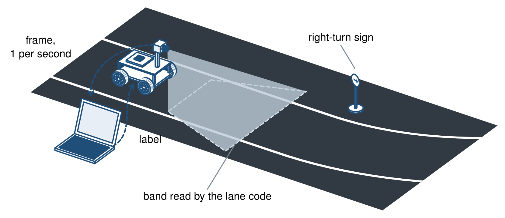
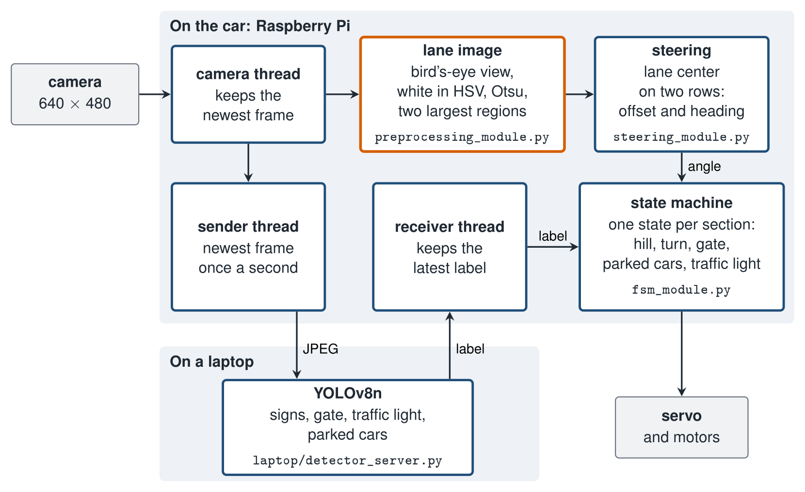
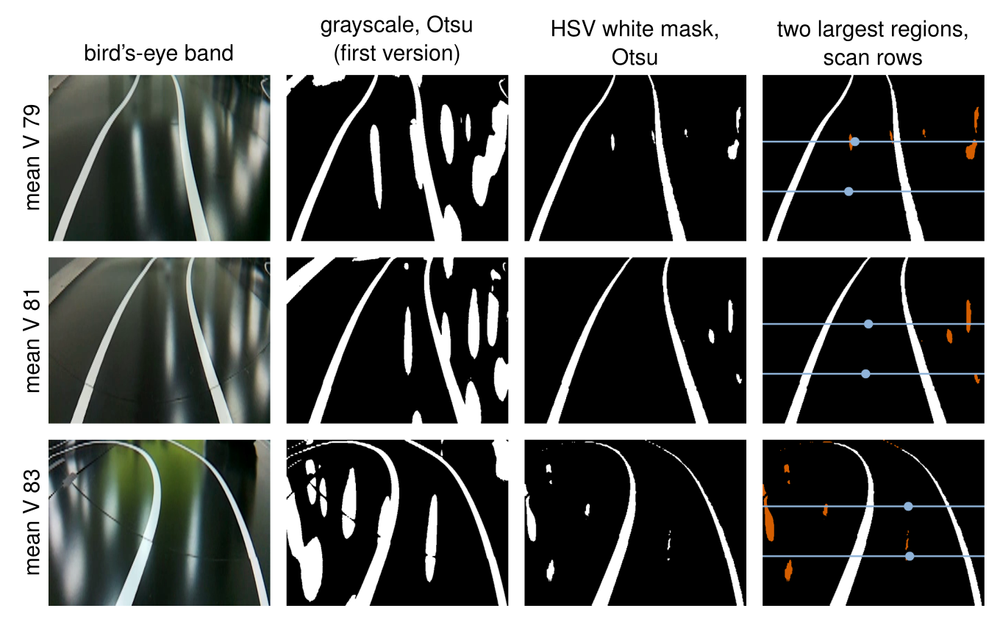
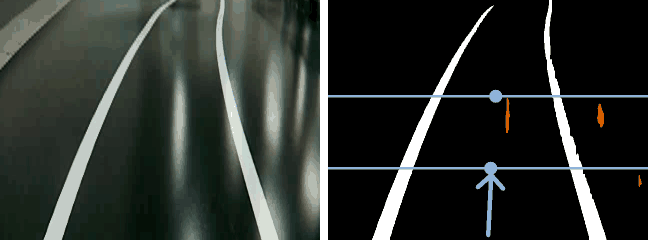
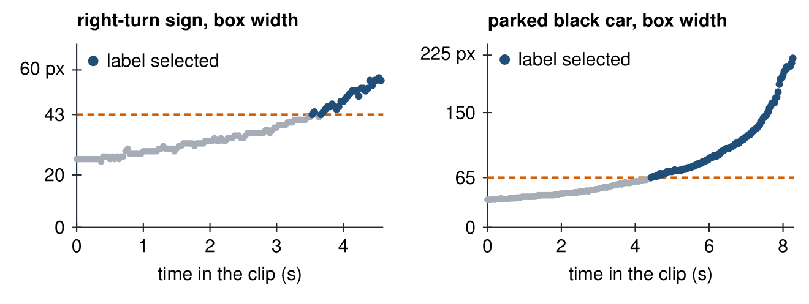
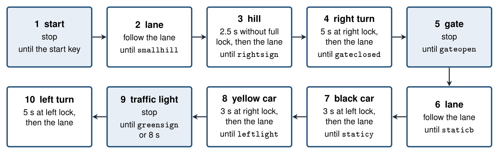
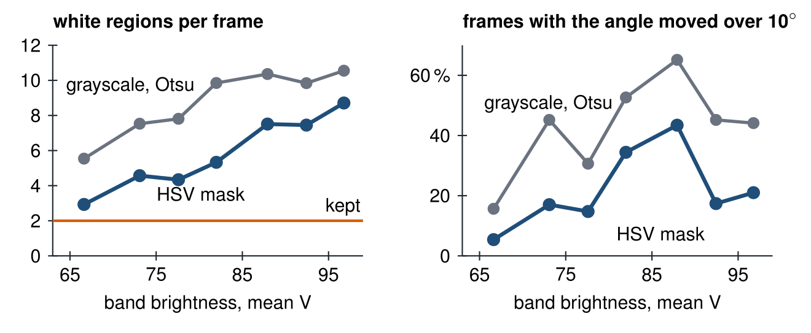

# Lane-Following Car

A camera-only model car that drives the course of the 2025 Autonomous Driving Contest at Chung-Ang University. It keeps its lane on the black floor of the course and passes a hill, a right turn, a gate, parked cars and a traffic light. Lane following runs on the car's Raspberry Pi; YOLOv8n runs on a laptop beside the track and sends back only the label the car needs.



Excellence Award at the contest. On 10,234 frames recorded by the car's camera on the track, the HSV white mask lets through a median of 5 white regions per frame where the grayscale threshold of the first version lets through 9, and the region filter keeps the two largest for steering.

**Technical summary**

- **Lane image under glare.** A bird's-eye band, an HSV white mask, Otsu's threshold, and a filter that keeps the two largest white regions.
- **Steering from two scan rows.** The lateral offset of the lane center and the heading between two rows, on every pass of the drive loop on the Raspberry Pi.
- **Detection off the car.** The newest frame goes to a laptop as a JPEG once a second; YOLOv8n and per-class rules return one label, and the drive loop never waits for it.
- **One state per course section.** Each state reacts only to the label of the next section.

## Problem and course

Every team drives the same kit, a Raspberry Pi with a camera, a steering servo and a DC drive motor, and may not change its structure or add another board. The course is a 6.3 m by 3.6 m black mat with white lane lines. Along it are a hill, model cars parked at the side of the lane, round turn signs, a tunnel, a gate that closes across the lane, and a traffic light with a left-turn sign. The car has to follow the lanes with its camera, stop at the closed gate and at the light, and pass the parked cars without touching them. A run is timed from start to finish.

The mat is glossy. The ceiling lights reflect on it as bright patches that pass a brightness threshold just as the lane lines do, and the brightness of the mat changes from one part of the room to another. This glare and the change of brightness were the hardest part of the lane following, and most of the work on the car went into the preprocessing.

## Design requirements

- The lane image has to hold over the brightness range of the course (mean HSV value of the band from 54 to 101 in the recordings) and leave out reflections and the lines of the neighboring lane.
- Steering has to follow the newest camera frame. Nothing in the drive loop may wait for the network or the detector.
- Nine kinds of objects have to be recognized, and YOLO could not run on the car's Raspberry Pi.
- A detection may start a maneuver only in its own section of the course and only when the object is close.

## System architecture



The camera thread keeps the newest frame. The drive loop builds the lane image from it, computes the steering angle, and passes the angle and the latest label to the state machine, which sets the servo and the motor. Beside the loop, a sender thread sends the newest frame to the laptop, and a receiver thread keeps the label that comes back.

| Part | Existing | Built in this project |
|---|---|---|
| Car | Contest kit: Raspberry Pi, camera, steering servo, DC motor, and its `afb` package for the camera, servo and motor | |
| Lane following | OpenCV | Lane image, steering and drive command (`car/modules/`) |
| Detection | Ultralytics YOLOv8n with COCO weights | Nine-class training on the car's frames, label rules (`laptop/detector_server.py`), frame and label link (`car/main.py`) |
| Course | | State machine (`car/modules/fsm_module.py`) |

## Lane image under glare



`car/modules/preprocessing_module.py` warps rows 190 to 390 of the 640 by 480 frame into a 640 by 480 bird's-eye band.

The first version (`cnn/make_dataset.py`) thresholded the grayscale band with Otsu's method. Otsu's method sets the threshold for each frame and so follows the change of brightness, but on the recorded frames it also passes the reflections (second column). The final code first keeps the pixels with saturation 0 to 30 and value 190 to 255 in HSV, the white of the lane lines, and thresholds the masked band with Otsu's method (third column). A 7 by 1 closing joins short vertical breaks so that a line stays one region.

The reflections that pass the mask are compact patches, while each lane line runs through the band as one long region. The filter therefore keeps the two largest regions of at least 150 px and drops the others (orange, fourth column).

## Steering from two scan rows

`car/modules/steering_module.py` takes the midpoint between the leftmost and the rightmost white pixel on two rows of the kept image, at 70 % and 40 % of its height. The lane angle combines the lateral offset of the lower midpoint and the heading of the line through both midpoints:

```text
angle = 85 + 48.5 * offset + 0.6 * heading      clipped to 30 to 150 degrees
```

The offset is the distance of the lower midpoint from the image center divided by half the image width (-1 to 1), and the heading is in degrees. The heading term turns the wheels at the entry of a curve while the car is still centered. If a row has fewer than two white pixels, the angle stays at 85.

In the lane-following states, `_drive_by_angle` in `car/modules/fsm_module.py` subtracts a 5 degree trim and compares the result with 78.5 degrees, the straight position of the servo. Within 11 degrees of it, the servo follows the angle with the motor command at 80. Beyond that, the servo goes to full lock, 33 or 147 degrees, with the motor command at 60. The first version classified the band as left, straight or right with a small CNN (`cnn/`) and set one of three fixed servo angles; the two-row angle gives a continuous command.



The clip above was recorded by the car's camera on the track and run through `car/modules/` frame by frame on a PC.

## Detection on a laptop

YOLO could not run on the car's Raspberry Pi, and the state machine needs one label at a time, not the boxes. The car therefore sends frames to a laptop and receives only the label.

- **Car** (`car/main.py`). The camera thread keeps the newest frame in memory. The sender thread encodes it as a JPEG at quality 85 and sends it over TCP once a second with a 4-byte length prefix, and it reconnects every 2 s if the link drops. The receiver thread listens for the laptop's JSON messages and keeps the latest label; each reply replaces it, and a reply with no box that passes the rules clears it. The drive loop reads that label without waiting, so a slow or missing detection never holds the steering.
- **Laptop** (`laptop/detector_server.py`). YOLOv8n runs at 640 px with a confidence threshold of 0.25, and rules reduce the boxes to one label. Each class has a minimum confidence. The signs, the hill and the parked cars also have a minimum box width, so their label is sent once the object is close. When several labels pass, the one with the highest priority is sent.

| Label | Object | Minimum confidence | Minimum box width | Priority |
|---|---|---|---|---|
| `smallhill` | hill | 0.40 | 240 px | 100 |
| `rightsign` | right-turn sign | 0.40 | 43 px | 80 |
| `gateclosed` | gate, closed | 0.20 | | 70 |
| `gateopen` | gate, open | 0.30 | | 60 |
| `staticb` | parked black car | 0.40 | 65 px | 60 |
| `staticy` | parked yellow car | 0.40 | 45 px | 50 |
| `redlight` | red light | 0.40 | | 45 |
| `greensign` | green light | 0.40 | | 40 |
| `leftsign` | left-turn sign | 0.40 | 37 px | 30 |



In two recorded clips run through the detector and the rules, the right-turn sign is detected from the first frame, but its label is selected only 3.5 s later, when the box reaches 43 px. The label of the parked black car is selected after 4.4 s, at 65 px.

The detector is YOLOv8n trained from COCO weights on frames of the car's camera on the track, labeled with boxes in nine classes, for 80 epochs at 640 px.

## One state per course section



`car/modules/fsm_module.py` gives each section of the course its own state. Each state waits only for the label of the next section, so a label that belongs to another section does not start a maneuver. The car starts when the start key (`s`) is entered.

- **Hill.** For 2.5 s the steering follows the lane angle without switching to full lock.
- **Right turn and parked cars.** The car turns at full lock for a fixed time: 5 s to the right at the right-turn sign, 3 s to the left at the black car and 3 s to the right at the yellow car. Lane following then resumes.
- **Gate and traffic light.** The car stops at the closed gate until the gate is open. At the light it stops until the green light or for at most 8 s, and then turns left at full lock for 5 s.

## Results

**Contest.** Excellence Award, 2025 Autonomous Driving Contest. The car completed the course, through the traffic light section.

**Lane image on recorded frames.** The 50 clips recorded by the car's camera on the track (10,234 frames) were run through the lane code of this repository on a PC, and the frames were grouped by the brightness of the band.



| | Grayscale, Otsu (first version) | HSV mask, Otsu |
|---|---|---|
| White regions per frame, median | 9 | 5 |
| Frames on which the lane angle differs by more than 10 degrees from the angle of the final code (two largest regions) | 40.8 % | 20.4 % |

The brighter the band, the more regions pass: from 5.5 to 10.6 per frame with the grayscale threshold and from 2.9 to 8.7 with the HSV mask.

**Detector.** On the validation split of the labeled frames, the trained YOLOv8n reaches a precision of 0.992, a recall of 0.995, an mAP50 of 0.992 and an mAP50-95 of 0.836.

## Repository structure

| Path | Contents |
|---|---|
| `car/main.py` | Camera, sender and receiver threads, drive loop |
| `car/modules/preprocessing_module.py` | Bird's-eye band, HSV white mask, Otsu, two largest regions |
| `car/modules/steering_module.py` | Scan rows and lane angle |
| `car/modules/fsm_module.py` | State machine over the course sections, drive command |
| `car/modules/drive_module.py` | Servo and motor commands |
| `laptop/detector_server.py` | YOLOv8n and the label rules |
| `cnn/` | First version: grayscale band, three-class CNN, its drive loop |
| `requirements.txt` | Package versions |

## Setup and run

On the car (Raspberry Pi OS with the kit's `afb` package and Picamera2, Python 3.10 or later):

```sh
cd car
python3 main.py      # type s and Enter to start
```

On the laptop, with the packages in `requirements.txt` and the trained weights saved as `laptop/best.pt`:

```sh
cd laptop
python detector_server.py
```

Set `LAPTOP_IP` in `car/main.py` and `PI_RESULT_HOST` in `laptop/detector_server.py` to the addresses of the laptop and the car. Start the car first: the detector server connects to the car's label port (8587) before it waits for frames on port 8485.
