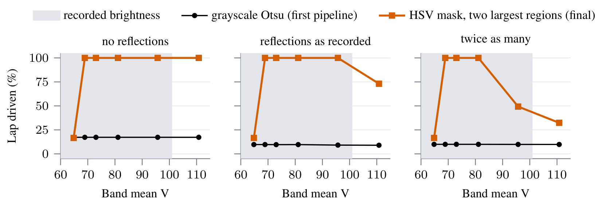

# Lane-Following Car

A camera-only model car for the 2025 Autonomous Driving Contest at Chung-Ang University (Excellence Award). It follows the lanes with its camera, and a YOLOv8n detector recognizes the signs, the gate, the traffic light and the parked cars on the course.


## Lanes under glare

The glossy floor reflects the ceiling lights as bright patches, and the brightness changes across the room. White pixels are selected in HSV before Otsu thresholding, and a filter then keeps only the two largest white regions to suppress those patches.


In a closed-loop simulation with the car's camera and the recorded reflections, this pipeline completes every lap over the recorded brightness range. With a plain grayscale threshold, the car leaves the lane within the first fifth of the lap.



## Driving on the car, detection on a laptop

YOLO could not run on the car's Raspberry Pi, so the work is split. The drive loop stays on the car. A sender thread sends the newest frame to a laptop once a second, and a receiver thread keeps the latest label. The drive loop reads that label without waiting, so the car keeps driving while a detection is in progress.

## One state per course section

The course is split into sections: hill, right turn, gate, parked cars. Each section has its own state, and each state reacts only to the label of the next section, so the labels of other sections do not trigger a maneuver.

## Run

On the car:

```sh
cd car && python3 main.py      # type s and Enter to start
```

On the laptop, with the trained weights saved as `best.pt`:

```sh
cd laptop && python detector_server.py
```

Simulation:

```sh
python sim/lane_sim.py results.csv
```
