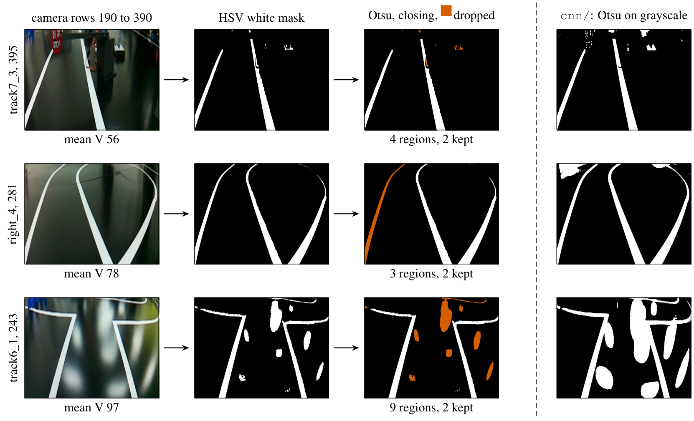
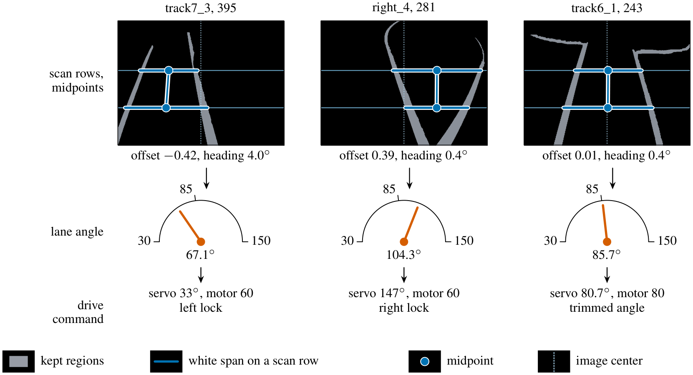
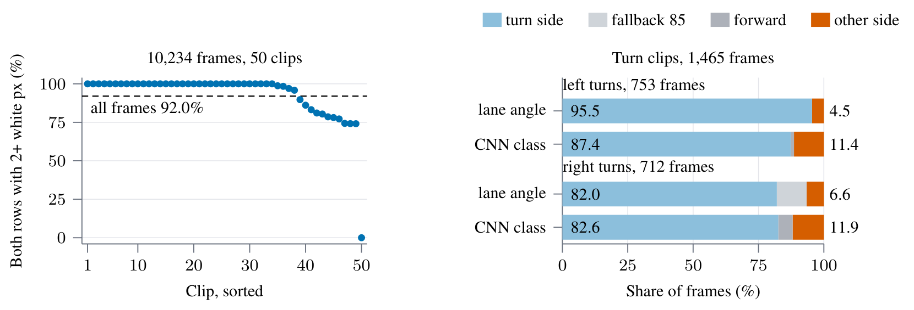

# Lane-Following Car

A camera-only autonomous model car for the 3rd Autonomous Model Car Contest of the Future Product Research Society at Chung-Ang University (2025), where every entry drove the same kit with fixed hardware and had to follow the lanes with its camera. The entry received the **Excellence Award**. I wrote the code in this repository.

- **Lane detection that holds under glare.** The glossy black floor reflects the ceiling lights as bright patches, and the brightness changes across the room. An HSV white mask before Otsu thresholding and a filter that keeps only the two largest white regions remove those patches. In a closed-loop simulation with the car's camera geometry and reflections matched to the recordings, this pipeline completes every lap over the recorded brightness range, where the first version's grayscale threshold leaves the lane within the first fifth of the lap.
- **Detection moved off the car.** YOLO could not run on the car's Raspberry Pi, so the car encodes the newest frame as a JPEG, sends it to a laptop once a second, and receives only the selected label as JSON. The drive loop never waits for it.
- **Hyperparameters tuned with Bayesian optimization** to get the most out of the limited training time.
- **The course run as a state machine.** The course is split into sections (hill, right turn, gate, parked cars), each with its own state, its trigger label and a lane-following or timed maneuver.


## How it works

| Part | |
|---|---|
| Car | Raspberry Pi 5 kit with camera, steering servo and DC drive motor on a TB6612FNG driver |
| Lane following | OpenCV on the Pi, on the newest 640 x 480 frame in each pass of the drive loop |
| Detection | YOLOv8n with 9 classes on a laptop, one frame per second over TCP |

**Lane pipeline.** `car/modules/preprocessing_module.py` takes the image rows from 190 to 390 and stretches them to 640 x 480. An HSV mask keeps the pixels with saturation from 0 to 30 and value from 190 to 255, the white of the lane lines. The masked image is blurred, thresholded with Otsu's method and closed with a 7 x 1 kernel, and the two largest white regions of at least 150 px are kept.



The same thresholds work on frames with a band brightness (mean HSV value) of 56, 78 and 97. Orange marks the reflections and neighboring lines that the region filter drops; the right column shows how much of the glare the first version's grayscale threshold lets through.

**Steering.** `car/modules/steering_module.py` reads two rows of the kept image, at 70% and 40% of its height, and takes the midpoint of the white pixels on each. The lane angle is

`angle = 85 + 48.5 x (lateral offset of the lower midpoint, -1 to 1) + 0.6 x (heading of the line through both midpoints, degrees)`

clipped to 30 to 150. The heading term starts the turn while the car is still centered at the entry of a curve.

**Drive command.** In the lane-following states, `car/modules/fsm_module.py` applies a 5 degree trim and compares the result with 78.5, the servo's straight position. Within 11 degrees of it the servo follows the angle with the motor at 80 (kit scale -255 to 255); beyond that the servo goes to full lock, 33 or 147 degrees, with the motor at 60.



**Detection on the laptop.** `car/main.py` keeps the newest camera frame in memory, and a sender thread encodes it as a JPEG at quality 85 and sends it over TCP once a second, reconnecting on its own if the link drops. `laptop/detector_server.py` runs YOLOv8n and reduces the boxes to one label: each class has a minimum confidence, the signs, the hill and the parked cars also have a minimum box width so that their label is sent once the object is close, and a priority picks one label when several pass. A receiver thread on the Pi keeps the latest label, and the drive loop reads it without waiting.

| Label | Minimum confidence | Minimum box width | Priority |
|---|---|---|---|
| hill | 0.40 | 240 px | 100 |
| right sign | 0.40 | 43 px | 80 |
| gate closed | 0.25 | | 70 |
| gate open | 0.30 | | 60 |
| black car | 0.40 | 65 px | 60 |
| yellow car | 0.40 | 45 px | 50 |
| red light | 0.40 | | 45 |
| green light | 0.40 | | 40 |
| left sign | 0.40 | 37 px | 30 |

**State machine.** `car/modules/fsm_module.py` gives each course section a state, and each state reacts only to the label of the next section, so a sign seen early or a detection of another class does not start a maneuver.

| State | Action | Leaves on |
|---|---|---|
| 1 | stop | start key |
| 2 | follow the lane | hill |
| 3 | 2.5 s on the lane angle without full lock (hill), then follow the lane | right sign |
| 4 | 5 s at right lock, then follow the lane | gate closed |
| 5 | stop | gate open |
| 6 | follow the lane | black car |
| 7 | 3 s at left lock, then follow the lane | yellow car |
| 8 | 3 s at right lock, then follow the lane | |

## Results

### Closed-loop simulation

`sim/lane_sim.py` renders what the car's camera sees of an oval track with white lane lines, neighboring lanes and ceiling-light reflections, runs the lane code and the drive command of this repository on each frame, and moves a kinematic model of the car. The camera is fitted to the lane positions in the recorded frames, and the floor, line and reflection colors and the number of reflection regions per frame match the recordings. Each point is the mean of three reflection layouts.


| Reflections | Final pipeline: full laps from band V 69 to 96 | First version: full laps |
|---|---|---|
| none | 12 of 12 | 0 of 18 |
| as recorded | 12 of 12 | 0 of 18 |
| twice as many | 9 of 12 | 0 of 18 |

The first version's threshold has no region filter, so the neighboring lane lines and the reflections pull the scan-row midpoints off the lane, and the car leaves the lane within 9 to 17% of the lap at every brightness.

### Recorded frames

`check/replay_lane.py` runs the lane pipeline on 10,234 frames from 50 clips recorded by the car's camera. On the six left-turn clips the lane angle points to the left on 95.5% of the frames, and on the four right-turn clips to the right on 82.0%, against 87.4% and 82.6% for the three-class CNN of the first version (`check/cnn_replay.py`).



`check/replay_detector.py` runs YOLOv8n and the label rules on every frame of 40 obstacle clips (8,728 frames). The gate and red-light labels are selected from the first frame, and the width rule holds the sign and parked-car labels until the object is close: 106 to 158 frames after the first detection for the signs and 57 to 220 for the parked cars.


## Earlier versions

The first lane follower (`cnn/`) thresholded the grayscale band and classified it as forward, left or right with a small CNN that set one of three fixed servo angles. A single-row version (`cnn/single_row_test.py`) steered from one scan row with an assumed lane width of 300 px. The final pipeline replaced both with the masked, region-filtered image and a continuous angle from two rows.

## Repository

```text
car/main.py                          camera, frame sender, label receiver, drive loop
car/modules/preprocessing_module.py  row band warp, white mask, two largest regions
car/modules/steering_module.py       scan rows and lane angle
car/modules/fsm_module.py            state machine over the course sections, drive command
car/modules/drive_module.py          servo and motor commands
laptop/detector_server.py            YOLOv8n and the label rules
cnn/                                 three-class lane CNN and the single-row test
sim/                                 closed-loop lane simulation and its results
check/                               replays of recorded frames and their results
docs/src/                            sources of the result figures
```

## Run

On the car, with the kit's `afb` package installed:

```sh
cd car
python3 main.py      # type s and Enter to start
```

On the laptop, with the trained weights saved as `best.pt`:

```sh
cd laptop
python detector_server.py
```

Simulation and result figures:

```sh
python sim/lane_sim.py sim/results_lane_sim.csv
python sim/summarize_sim.py sim/results_lane_sim.csv docs/src
python check/make_figure_data.py docs/src
cd docs/src && pdflatex sim.tex && pdflatex replay.tex && pdflatex label_rule.tex
```

Replays, with the recordings and the weights (not in this repository):

```sh
python check/replay_lane.py RECORDINGS_DIR > lane.csv
python check/cnn_replay.py steering_classification_lightcnn.h5 RECORDINGS_DIR > cnn.csv
python check/summarize_lane.py lane.csv cnn.csv
python check/replay_detector.py best.pt OBSTACLE_RECORDINGS_DIR > detector.csv
python check/summarize_detector.py detector.csv
```

`requirements.txt` lists the package versions.
